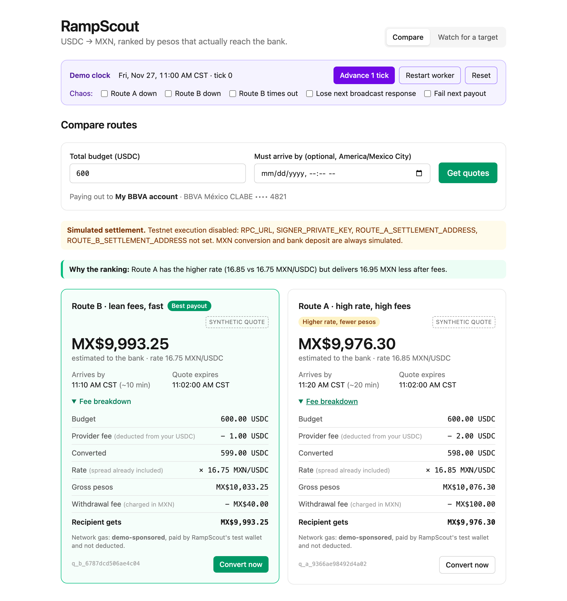
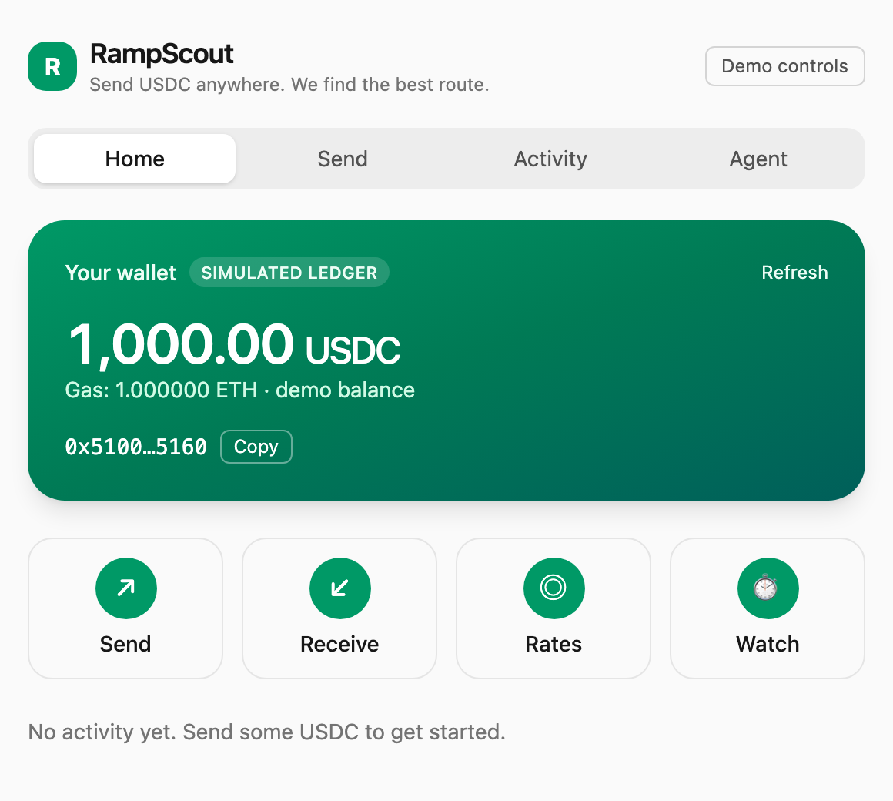
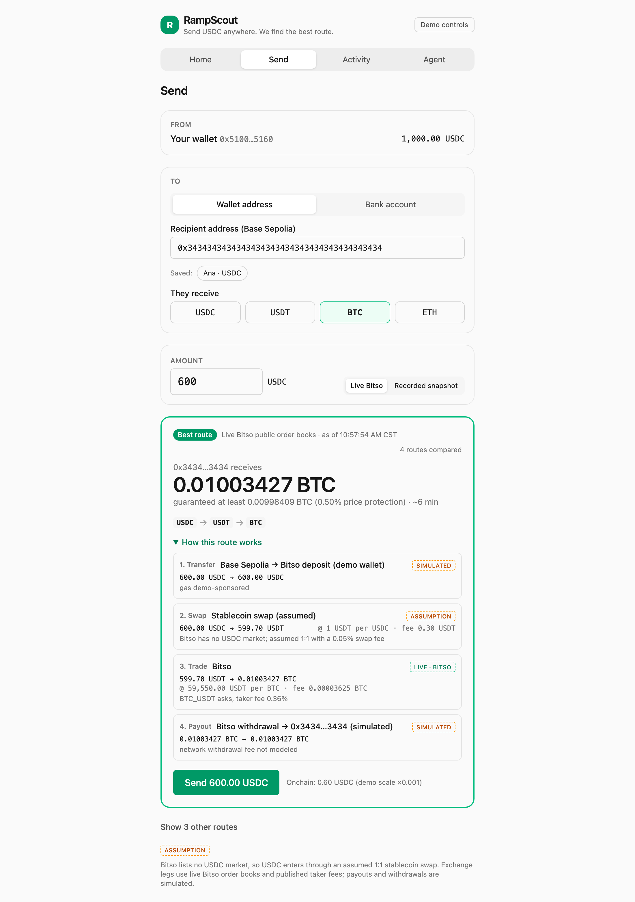
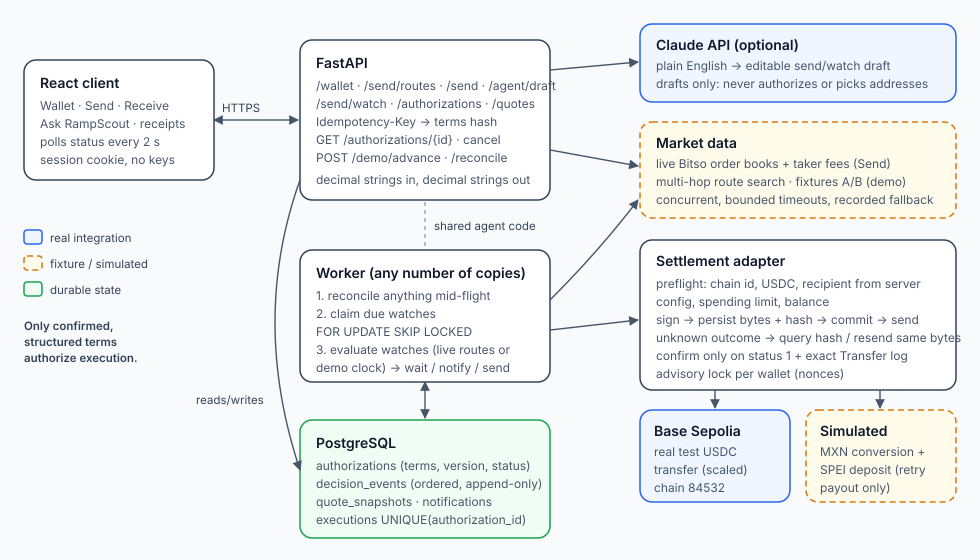
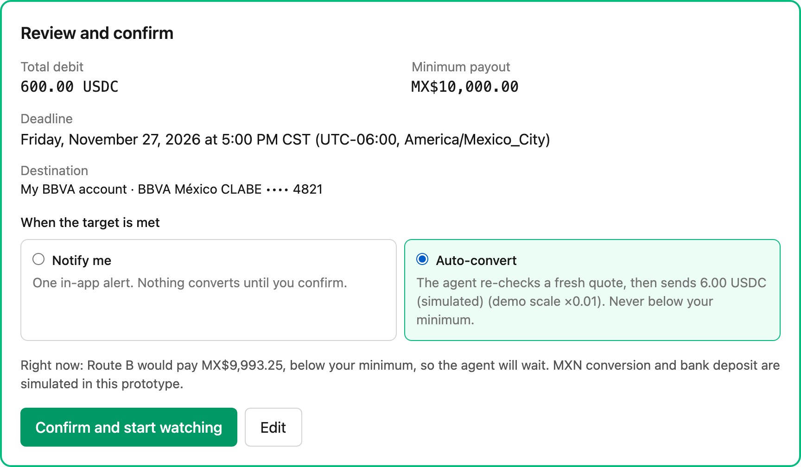
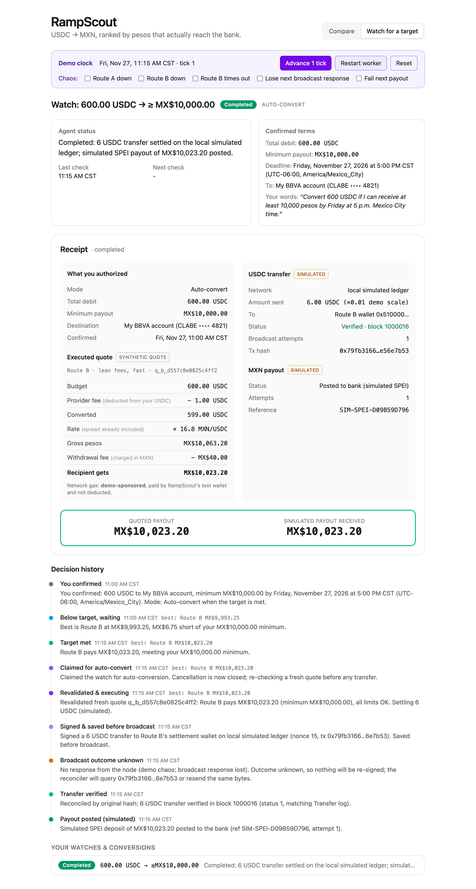

# RampScout

[](https://github.com/JayanthBalu06/rampscout/actions/workflows/ci.yml)

**Live demo: https://rampscout.onrender.com** (free tier; first load after idle takes ~1 min)

**Rates lie, payouts don't.** A wallet that sends USDC to anyone (paste a wallet address and pick what they receive: USDC, USDT, BTC or ETH; or pay a bank account in MXN, ARS, COP or BRL) and automatically finds the route that delivers the most, using **live Bitso order books**. An AI agent can also wait for a target payout and act only within limits you approve.

Built for the **Agentic Payments & AI** track. The USDC transfer is **real on Base Sepolia**; exchange legs are priced from **live Bitso market data**; fiat payouts are simulated, and every screen labels which is which.



## Why

A freelancer paid in USDC sees "16.85 MXN/USDC" from one provider and "16.75" from another and picks the higher number. After a 2 USDC fee and a 100-peso withdrawal fee, the higher rate pays **MX$16.95 less**. RampScout ranks routes by what the recipient actually receives:

```
net MXN = floor_to_centavos( (input USDC − USDC fee − gas) × rate − MXN withdrawal fee )
```

| Tick | Route | Rate | USDC fee | MXN fee | **Net MXN** | ETA |
|---|---|---|---|---|---|---|
| 0 | A | 16.85 | 2 | 100 | 9,976.30 | 20 min |
| 0 | B | 16.75 | 1 | 40 | **9,993.25** | 10 min |
| 1 | B | 16.80 | 1 | 40 | **10,023.20** | 10 min |

Users can convert now, or ask the agent: *"Convert 600 USDC if I can receive at least 10,000 pesos by Friday at 5 p.m. Mexico City time."* Waiting is optional, and it can end with a worse quote or no conversion at all. The UI says so before you confirm.

## The wallet: send anywhere, best route found automatically

| Home | Send (pasted address, recipient wants BTC) |
|---|---|
|  |  |

- **Home:** your wallet address and live balances (read from Base Sepolia), with **Send / Receive** (QR code), recent activity, and the agent's **Rates** and **Watch** tools.
- **Send:** paste a recipient address and choose what they receive, or pick a bank account. Enter an amount. That's all. RampScout searches every route up to three conversions deep across Bitso's live markets (USD, USDT, BTC, ETH, MXN, ARS, COP, BRL) and ranks them by what the recipient actually receives:

```
600 USDC → Mamá (BBVA, MXN), live Bitso data:
  #1 USDC → USD → MXN           MX$11,327.44
  #2 USDC → USDT → MXN          MX$11,318.51   (−MX$8.93)
  #3 USDC → USD → USDT → MXN    MX$11,287.91   (−MX$39.53)
  …  USDC → USDT → BTC → MXN    MX$11,268.60   (−MX$58.84)
```

- **New addresses are confirmed once.** A pasted address can be quoted immediately, but the first send to it requires ticking "I've checked every character"; it's then saved. Sends only ever target saved, confirmed recipients by ID, and the model never touches them.
- **Exact, not approximate.** Each exchange hop walks the real order book level by level (depth and slippage included), charges Bitso's published taker fee for that market, and rounds down to the currency's minor unit, because each hop is a separate trade. With a handful of currencies, exhaustive search over simple paths is exact and takes milliseconds. Shortest-path shortcuts like Dijkstra over −log(rate) are only correct when every fee is a pure percentage, and fixed fees, book depth and per-hop rounding break that (`test_routing.py::test_fixed_fee_flips_ranking_by_size`).
- **Honest about gaps.** Bitso lists no USDC market, so USDC enters through a stablecoin-swap leg explicitly labeled *assumption* (1:1, 0.05% fee, configurable). If Bitso is unreachable, a recorded snapshot is used and flagged.
- **Price protection without asking the user.** The confirmed minimum is the quote minus 0.5%. Right before signing, the exact path is **re-priced on fresh market data**; if the recipient would get less than the minimum, nothing is sent.
- **Same safety rails as the agent:** idempotency keys, one execution per authorization, save-before-broadcast, reconciliation by hash.

| Contact | Route | What's real |
|---|---|---|
| Bank (MXN, ARS, COP, BRL) | onchain USDC → venue wallet, then Bitso conversions, then payout | USDC transfer real (testnet); prices live; payout simulated |
| Wallet, receives USDC | direct onchain transfer to the address | fully real on Base Sepolia |
| Wallet, receives USDT / BTC / ETH | onchain USDC → venue wallet, Bitso conversions, withdrawal to the address | USDC transfer real; prices live; withdrawal simulated |

## What is real and what is simulated

| Layer | In this prototype | Labeled as |
|---|---|---|
| Send-flow exchange prices | **Live Bitso public order books + published taker fees** (or a recorded snapshot, flagged) | "Live · Bitso" / "Recorded" |
| USDC → USD/USDT entry leg | Assumed 1:1 swap with a small fee (Bitso has no USDC market) | "Assumption" |
| Compare/Watch providers A and B | Synthetic fixtures with a reproducible tick script; fresh quote id and expiry per fetch | "Synthetic quote" |
| Payout math, ranking, eligibility | Real (decimal, deterministic, tested) | n/a |
| Natural-language drafting | Claude API with structured output (optional); a deterministic rules parser when no key is set | "Drafted by Claude / rules parser" |
| USDC transfer | **Real ERC-20 transfer on Base Sepolia** when a funded test wallet is configured, scaled 1:100 for faucet limits. Otherwise a local simulated ledger running the same state machine. | "Testnet · real transfer" + explorer link, or "Simulated" |
| Network gas | Paid by the demo wallet, shown separately, not deducted | "Gas: demo-sponsored" |
| Provider fee deduction, MXN conversion, SPEI deposit | Simulated | "Simulated payout" |

## Architecture



- **React + TypeScript** (Vite, Tailwind): compare routes, build and review a watch, follow its decision timeline, view receipts. Polls the API. Money is handled as decimal strings and never parsed into JS numbers.
- **FastAPI**: validates input (rejects JSON numbers for money), binds requests to a demo session cookie, persists confirmations with idempotency keys, returns quotes and the audit history.
- **Worker**: reconciles anything left mid-flight, claims due watches with `SELECT … FOR UPDATE SKIP LOCKED`, evaluates them, and executes authorized transfers. Safe to run several copies.
- **PostgreSQL**: authorizations (confirmed terms, version, status, next check), quote snapshots, ordered decision events, notifications, and executions (`UNIQUE(authorization_id)`).
- **Settlement adapter**: one state machine for Base Sepolia (`web3.py`) and the local ledger.

## The agent loop and its limits

```
every tick (demo) / every POLL_INTERVAL (live), for each due watch, row-locked:
  deadline passed?                          → expire. Nothing converts, ever, after the deadline.
  fetch fresh quotes from all providers concurrently, each with a timeout
  provider errors                           → recorded separately; other routes still count
  drop: unsupported destination, expired quote, over budget,
        ETA + 2-min safety margin past the deadline
  rank by net MXN, then earlier ETA, then route id
  best < minimum                            → "MX$6.75 short", keep watching, set next check
  best ≥ minimum and mode = notify          → one in-app notification, close. Never signs.
  best ≥ minimum and mode = auto            → claim (cancel now returns 409)
        refresh that route's quote and re-check EVERYTHING right before signing:
        status, terms hash, deadline, expiry, budget, ETA, minimum, destination,
        recipient, spending limit, balance
        any failure                         → release the claim, keep watching while time remains
        all pass                            → create the single execution, then settle
```

**What the model can and cannot do.** Claude turns a sentence into an editable `IntentDraft` (amount, currency, minimum, destination alias, deadline, time zone, mode), and asks about anything missing or ambiguous: "CST" could mean Chicago or Mexico City, and "Friday 9 a.m." might already have passed. The server re-validates every field. The model cannot create an authorization, choose a blockchain address, or trigger execution. Only structured terms that the user reviewed and confirmed authorize anything. Without an API key the rules parser handles the same sentence, and the form always works.

**Hard limits:** `MAX_AUTHORIZATION_USDC` (1000), `MAX_WATCH_DAYS` (7), `MAX_ONCHAIN_TRANSFER_USDC` (10), `DAILY_ONCHAIN_RUNS` (20), 2-minute arrival safety margin, and a per-session rate limit on model calls. Recipients come only from server config (`ROUTE_*_SETTLEMENT_ADDRESS`), looked up by route ID.

## Reliability guarantees, each with a test

| Guarantee | How | Test |
|---|---|---|
| At most one payment per authorization | `UNIQUE(authorization_id)` on executions, row-locked claims | `test_watch.py::test_concurrent_workers_process_a_watch_once` (4 racing workers) |
| Duplicate confirmations create one authorization | Idempotency key bound to a SHA-256 of the canonical terms; `ON CONFLICT DO NOTHING` | `test_authorizations.py::test_concurrent_duplicate_confirmations_create_one_authorization` (5 racing requests) |
| Same key with different terms is rejected | terms-hash comparison → 422 | `test_same_key_different_terms_rejected` |
| No nonce collisions | `pg_advisory_xact_lock` per wallet; nonce = max(chain pending, last stored + 1) | `test_settlement.py::test_signing_is_serialized_with_distinct_nonces` |
| Signed tx is durable before it leaves the process | sign → persist bytes and hash → commit → broadcast | every settlement test asserts the event order `signed → broadcast` |
| Lost broadcast response never re-signs | status `unknown`; the reconciler queries the original hash | `test_lost_broadcast_response_reconciles_by_original_hash` |
| Broadcast lost before reaching the node | resend the **identical bytes**, never re-sign | `test_broadcast_lost_before_node_resends_identical_bytes` |
| Crash between creating the execution and signing | stale unsigned execution is voided and the claim released | `test_unsigned_execution_with_stale_quote_is_voided_on_restart` |
| Transfer counts only when verified | receipt status 1 **and** an exact `Transfer(signer → recipient, amount)` log from the USDC contract | `test_bad_receipt_never_posts_payout` (reverted, mismatched) |
| Payout failure retries the payout only | "transfer confirmed / payout pending", same execution ID | `test_payout_failure_retries_payout_only` |
| Notify never signs; canceled or expired never execute | state machine + spy settler | `test_notify_never_signs_and_notifies_once`, `test_canceled_watch_never_executes`, `test_deadline_closes_watch_even_if_later_quote_qualifies` |
| Stale quote triggers revalidation | refresh before signing; release on failure | `test_stale_quote_triggers_revalidation_and_releases_claim` |
| Signing material never leaks | log redaction processor; API schemas exclude signed bytes | `test_signed_bytes_and_keys_never_leave_the_server` |
| Exact money | Decimal, end-only ROUND_DOWN, strings over JSON | `test_pricing.py` (the brief's three payouts as exact strings) |

The demo UI exposes the failure paths as **chaos toggles** (provider down or timeout, lost broadcast response, failed payout) and a **Restart worker** button, so you can watch recovery happen live.

| Review before confirming | Receipt after a lost broadcast response, reconciled |
|---|---|
|  |  |

## Run it

Requires Docker, Python 3.11, and Node 24 (local dev only).

**One command (everything in Docker):**

```bash
cp .env.example .env
make stack                 # http://localhost:8000 (API under /api, UI at /)
```

**Local development:**

```bash
make setup                 # venv + npm install + .env
make up                    # Postgres in Docker + migrations (dev and test DBs)
make seed                  # demo user's destination + a demo session (optional; the API also does this lazily)
make api                   # FastAPI on :8000 with reload
make worker                # background worker
make web                   # Vite on :5173, proxies /api → :8000
```

**Tests:**

```bash
make test                  # 122 backend tests (pytest against Postgres) + frontend unit tests (Vitest)
make lint                  # ruff, mypy (strict on the domain layer), oxlint, tsc
make e2e                   # 9 Playwright journeys against the Docker stack
```

**Demo:** [`docs/DEMO_SCRIPT.md`](docs/DEMO_SCRIPT.md) is the two-minute talk track. `make demo` runs the same journey in a terminal.

**Real testnet transfers:** [`docs/TESTNET_SETUP.md`](docs/TESTNET_SETUP.md) covers `make wallet`, the faucets, `make check-testnet`, and the verified network facts.

**Deploy:** `render.yaml` is a free-tier Render blueprint: one web service serving the API under `/api` and the UI on the same origin, with the worker loop embedded (`EMBEDDED_WORKER=true`), plus Postgres. Enter secrets in the Render dashboard. A hosted demo falls back to the labeled simulated ledger whenever the signer's test USDC drops below one transfer (`MIN_SIGNER_USDC`) or the daily cap is reached.

### Environment

See [`.env.example`](.env.example). Key variables:

| Variable | Purpose |
|---|---|
| `DATABASE_URL` | Postgres (`postgres://` URLs from hosts are normalized) |
| `DEMO_MODE`, `CLOCK_MODE` | Demo endpoints; `fixture` (manual clock per session) or `system` (wall clock) |
| `RPC_URL`, `RPC_SEND_URL` | Base Sepolia RPC; optional separate send endpoint |
| `EXPECTED_CHAIN_ID` | `84532`, checked live before enabling testnet |
| `USDC_CONTRACT` | `0x036CbD53842c5426634e7929541eC2318f3dCF7e`, checked live for code, `USDC`, 6 decimals |
| `SIGNER_PRIVATE_KEY`, `SIGNER_ADDRESS` | Dedicated test wallet (`make wallet`) |
| `ROUTE_A_SETTLEMENT_ADDRESS`, `ROUTE_B_SETTLEMENT_ADDRESS` | Server-configured provider wallets |
| `DEMO_TRANSFER_SCALE` | `0.01`: 600 authorized → 6 test USDC onchain (Circle's faucet gives 20 USDC / 2 h) |
| `MARKET_SOURCE` | `live` (Bitso public API, no key) or `recorded` (bundled snapshot) |
| `STABLE_SWAP_FEE_BPS`, `SLIPPAGE_BPS`, `MAX_ROUTE_HOPS` | Assumed USDC entry fee, price-protection tolerance, search depth |
| `ANTHROPIC_API_KEY`, `ANTHROPIC_MODEL` | Optional; defaults to `claude-opus-5-5` at low effort |

A missing RPC URL or signer disables testnet execution, and every page shows the reason.

## Verification status

What was actually run while building this, as opposed to what is only designed:

| Flow | Status |
|---|---|
| Send: live multi-hop routing to MXN, ARS, COP and USDC wallet contacts; re-price before signing; contact validation | ✅ unit, API and browser tests (recorded snapshot); live Bitso routing exercised in the browser |
| Send on Base Sepolia (bank route) | ✅ live Bitso route USDC → USD → MXN re-priced and paid; 0.60 USDC transfer [`0xd510…3fa7`](https://sepolia.basescan.org/tx/0xd510fe1c1118965c1a324b4c6b6208ad630e4d8e412f9a801950731433c23fa7) (block 61351171) |
| Quote comparison, the brief's exact payouts, exclusions, provider outage and timeout | ✅ unit, API and browser tests |
| Notify watch: tick 0 waits, tick 1 notifies, survives reload | ✅ API and browser (Playwright) |
| Auto watch: claim → revalidate → settle → receipt | ✅ API and browser, local simulated ledger |
| Convert now, including the "quote changed" re-confirmation | ✅ API and browser |
| Lost broadcast → reconcile by original hash; resend identical bytes; payout retry | ✅ tests and browser; the worker container recovered a lost broadcast on its own within 5 s |
| Full stack in Docker (`make stack`) and the scripted demo (`make demo`) | ✅ |
| Base Sepolia network facts (chain ID, USDC contract, decimals) | ✅ verified live via public RPC and official docs |
| Base Sepolia transaction build and sign, Transfer-log parsing | ✅ offline tests (EIP-1559 tx recovered to the signer) |
| **Live Base Sepolia transfer** | ✅ auto watch matched at tick 1, revalidated, sent 6 test USDC (1:100 scale) to Route B's wallet, verified by receipt and Transfer log: [`0xc9c1…7660`](https://sepolia.basescan.org/tx/0xc9c16521aa3513dc7e05ae71c91213aa987427c4ac829958e29a35418f237660) (block 61330798) |
| **Claude drafting against the live API** | ⏳ needs `ANTHROPIC_API_KEY`; covered by mocked tests, and the rules parser ran instead |
| GitHub Actions CI (lint, types, 91 backend tests on Postgres, unit tests, Playwright E2E) | ✅ green on GitHub |
| Hosted demo on Render | ✅ https://rampscout.onrender.com — real 0.60 test USDC transfer (1:1000 scale) from the hosted app: [`0x93cd…0227`](https://sepolia.basescan.org/tx/0x93cdd254a96b05796fa6fbfaf2c5c1d0e3aa31014ebb28e1f68e848935140227) |

## Future work (not in this prototype)

- **Measured outcomes:** backtest the watch policy against immediate best-route execution over the same historical start times, counting expired watches and worse-than-immediate outcomes. None of the prototype's numbers are measured market outcomes.
- Real execution on the exchange legs (authenticated Bitso trading and SPEI withdrawals); today those legs are priced live but settled as a simulation.
- A live USDC entry price (DEX quote on Base) instead of the labeled 1:1 assumption.
- Live data for the watch agent (it uses the reproducible fixtures today).
- User-paid gas: the payout formula already has the `gas_cost_usdc` term, so ranking would account for it with no refactor.
- MXN → USDC direction, more chains, real accounts and auth, and KYC.

## Repo map

```
backend/rampscout/domain      pure payout math, multi-hop routing, eligibility, decision, clocks (mypy --strict)
backend/rampscout/providers   live Bitso adapter (+ recorded snapshot), fixture providers, concurrent fetch
backend/rampscout/agent       evaluate (watch loop), execute (claim/revalidate), intent (Claude + rules)
backend/rampscout/settlement  chain settler, Base Sepolia client, simulated ledger, reconciler, status
backend/rampscout/api         FastAPI app, schemas, routes, production server (API + UI)
frontend/src                  React app;  frontend/e2e  Playwright journeys
docs/                         SPEC, PLAN, TESTNET_SETUP, DEMO_SCRIPT, architecture.svg
```
